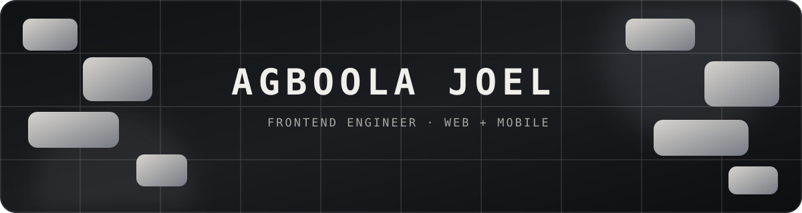

<a href="mailto:oluwafisayojoel@gmail.com">Email</a> &nbsp;·&nbsp;
<a href="https://x.com/Jud_the_fifth">X</a> &nbsp;·&nbsp;
<a href="https://www.linkedin.com/in/agboola-joel-23138526a/">LinkedIn</a> &nbsp;·&nbsp;
<a href="https://agboola-joel.notion.site/JOEL-O-AGBOOLA-2417cf9e407280769c38d332dd1764b6">Portfolio</a>

 

<table>
  <tr>
    <td width="34%" valign="top">
      <b>Now</b>  
      Building fintech products: trading apps, loan and asset management tools, and multi-tenant whitelabel dashboards.
    </td>
    <td width="33%" valign="top">
      <b>Range</b>  
      The full frontend stack, with enough backend fluency (NestJS, Prisma, tRPC) to ship end-to-end.
    </td>
    <td width="33%" valign="top">
      <b>Next</b>  
      Learning Dart and going deeper into NestJS. I write on <a href="https://x.com/Jud_the_fifth">X</a>.
    </td>
  </tr>
</table>

### What I build

<table>
  <tr>
    <td width="34%" valign="top"><b>Design systems</b> Component libraries that keep product teams consistent.</td>
    <td width="33%" valign="top"><b>Mobile POS and trading</b> React Native apps that move real money.</td>
    <td width="33%" valign="top"><b>Type-safe Next.js</b> Apps integrated with REST and NestJS backends.</td>
  </tr>
  <tr>
    <td valign="top"><b>Whitelabel dashboards</b> One codebase, many tenants, many brands.</td>
    <td valign="top"><b>Legacy migrations</b> Old React codebases moved to Next.js.</td>
    <td valign="top"><b>Performance</b> Code splitting, lazy loading, lean state.</td>
  </tr>
</table>

### Toolbox

`React` `Next.js` `React Native` `TypeScript` `JavaScript` `Tailwind` `MUI` `Figma`

`Node.js` `NestJS` `Express` `Prisma` `tRPC` `PostgreSQL` `MySQL` `MongoDB` `Git`

### Contributions

<table>
  <tr>
    <td width="50%" align="center">
      
    </td>
    <td width="50%" align="center">
      
    </td>
  </tr>
  <tr>
    <td colspan="2" align="center">
      
    </td>
  </tr>
  <tr>
    <td colspan="2" align="center">
      
    </td>
  </tr>
</table>

Ask me about React, Next.js, React Native, Node.js, NestJS, or system and UI design.

